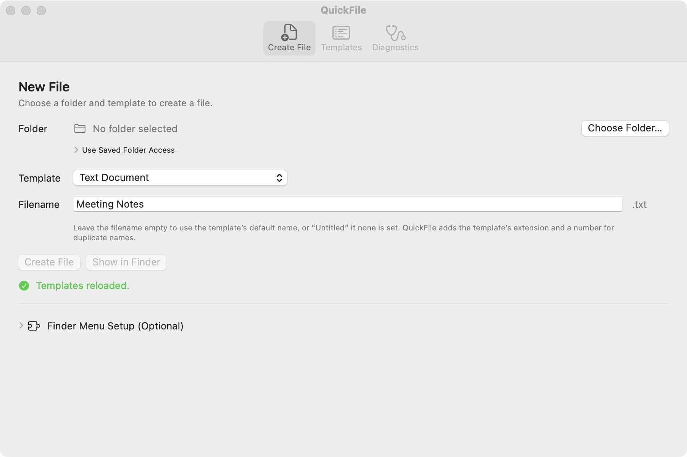
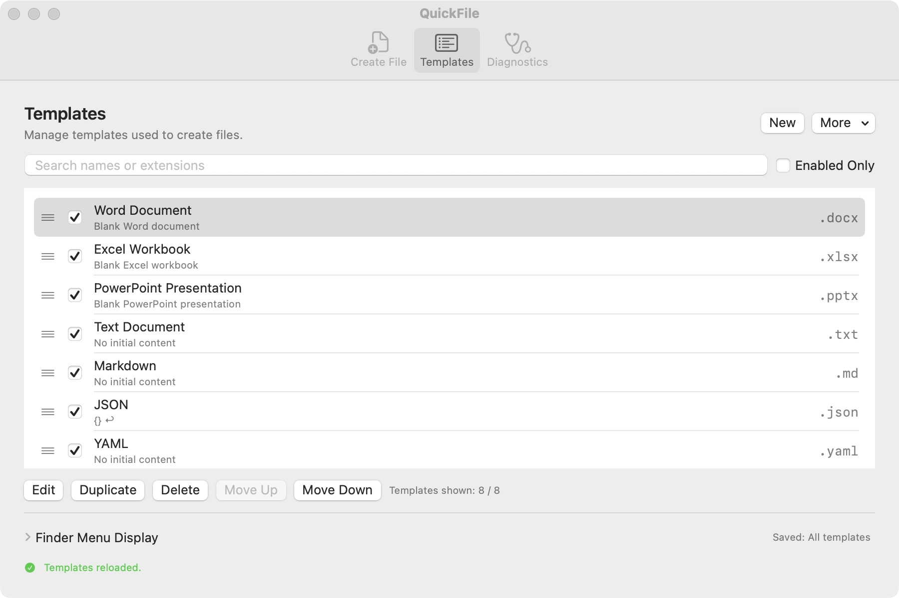

# QuickFile

English · [简体中文](README.zh-CN.md)

**Create a new file right where you need it.**

Open a folder in Finder, right-click an empty space, and choose a file type. QuickFile creates the file in that folder. You can also create files from the QuickFile window.

[Download for Mac](https://github.com/haoyang7/QuickFile/releases/tag/v0.1.0-beta.2) · [Installation help](INSTALLATION.en.md) · [Report a problem](https://github.com/haoyang7/QuickFile/issues)

## What can I create?

Blank Word documents, Excel workbooks, PowerPoint presentations, text files and Markdown notes. JSON, YAML and Shell templates are also included.

You can make your own text templates, too. A template is a starting point you can use again—for example, the same headings for every meeting note. Office documents are edited in your usual office app.

## Create your first file

After [installing QuickFile](INSTALLATION.en.md):

1. Open **Create File** and click **Choose Folder…**. Pick where you want the file to go.
2. Choose **Text Document** and type a name, such as `Meeting Notes`.
3. Click **Create File**. Use **Show in Finder** to find it.

If a file with that name already exists, QuickFile adds a number. Your existing file stays untouched.

## Use it from Finder

Set this up once:

1. In QuickFile, open **Diagnostics → Manage Extensions…**.
2. Turn on QuickFile in the Finder extensions list, then click **Done**.
3. Open a folder in Finder. Right-click an empty space and choose **New File → Text Document**.

If QuickFile asks to use that folder, select the same folder and confirm. You can cancel without creating a file. Once set up, the Finder menu works even when the QuickFile window is closed.

## Keep your favourite templates handy

In **Templates**, add your own starting text, edit a template, or drag the rows to change their order. Uncheck a template to hide it from the creation menu. **More** contains import and export options.

In **QuickFile → Settings → General**, you can choose English, Simplified Chinese or the system language. You can also turn on **Open files after creation** to open a new file in its usual app. It is off by default.

*Screenshots: v0.1.0-beta.2, build 98.*

## Before you install

- **Mac requirements:** macOS 13 or later; one download for Apple Silicon and Intel. This is a Beta, and not every Mac or macOS version has been tested. See the [release notes](https://github.com/haoyang7/QuickFile/releases/tag/v0.1.0-beta.2) for the tested range.
- **First launch:** this Community build has not been notarized by Apple. macOS may ask you to approve opening it. The [installation guide](INSTALLATION.en.md) shows the steps.
- **Updates:** download and install new versions yourself; this build has no automatic updater.
- **Privacy:** no account, ads or usage tracking. Templates and settings stay on your Mac. Folder access is granted when you choose a folder. See the [privacy details in Simplified Chinese](PRIVACY.md).

Try your first file in a test folder. Cloud folders, external drives and network drives still need more testing.

## Need help?

**No Finder menu?** Check the QuickFile switch in the extensions list, click **Done**, then return to QuickFile and click **Refresh Status**.

**Cannot create a file?** Check that you selected the right folder and can save files there. QuickFile’s **Diagnostics** page can help you check folder access.

See [installation and troubleshooting](INSTALLATION.en.md), or [open an issue](https://github.com/haoyang7/QuickFile/issues) with what you clicked, what happened, and your macOS and QuickFile versions. Remove personal information from screenshots before sharing them.

## For contributors

- English: [Translation guide](LOCALIZATION.md) · [MIT License](LICENSE)
- Simplified Chinese: [Build and contribute](CONTRIBUTING.md) · [Architecture](ARCHITECTURE.md) · [Changelog](CHANGELOG.md)
