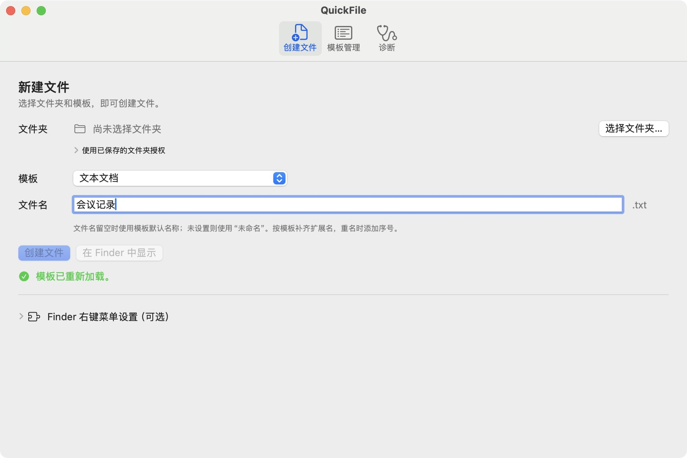
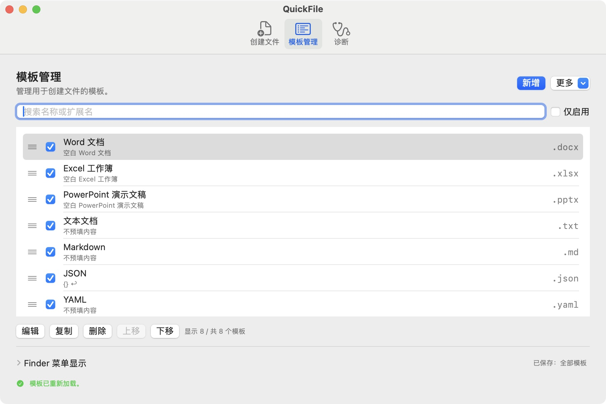

# QuickFile

[English](README.md) · 简体中文

**想在哪个文件夹新建文件，就在那里点一下。**

打开 Finder 文件夹，在空白处点鼠标右键，选一种文件，QuickFile 就会把新文件放在这里。你也可以打开 QuickFile，在窗口里完成操作。

[下载 Mac 版](https://github.com/haoyang7/QuickFile/releases/tag/v0.1.0-beta.3) · [安装帮助](INSTALLATION.md) · [反馈问题](https://github.com/haoyang7/QuickFile/issues)

## 可以新建哪些文件？

空白的 Word 文档、Excel 工作簿、PowerPoint 演示文稿、文本文件和 Markdown 笔记。也准备了 JSON、YAML 和 Shell 模板。

你还可以准备自己的文本模板。模板就是一份可以反复使用的开头，比如每次会议记录都要用的几个标题。Office 文档的内容在你平时使用的办公软件中编辑。

## 先创建一个文件试试

[安装 QuickFile](INSTALLATION.md) 后：

1. 打开“**创建文件**”，点击“**选择文件夹…**”，选好新文件要放的位置。
2. 模板选“**文本文档**”，文件名输入“会议记录”。
3. 点击“**创建文件**”。再点“**在 Finder 中显示**”，就能找到它。

如果已经有同名文件，QuickFile 会在新文件名后加上数字，原来的文件不会被覆盖。

## 在 Finder 右键菜单里创建

第一次使用时，先打开开关：

1. 在 QuickFile 中点击“**诊断 → 打开扩展管理…**”。
2. 在 Finder 扩展列表中打开 QuickFile 开关，再点“**完成**”。
3. 回到 Finder，打开一个文件夹，在空白处点右键，选择“**新建文件 → 文本文档**”。

如果 QuickFile 询问是否可以使用这个文件夹，选中刚才的文件夹并确认。点取消就不会创建文件。设置完成后，关掉 QuickFile 窗口，也能继续使用 Finder 右键菜单。

开发中的 build 108 还提供独立的系统服务入口：在 Finder 选中一个文件夹，选择“Finder → 服务 → 使用 QuickFile 新建文件…”，再在 QuickFile 中点击“选择这个文件夹…”并确认保存位置。之后选择模板和文件名，点击“创建文件”。可在 macOS 的“键盘 → 键盘快捷键 → 服务”设置中为它分配快捷键。此入口尚未包含在公开的 Beta 3 中；系统注册、快捷键和云目录支持范围，须按[验收指南](BETA_TEST_GUIDE.md)对最终候选和目标环境分别核对。

## 把常用模板放在手边

在“**模板管理**”里，可以新增自己的文字、编辑模板，或拖动列表改变顺序。不常用的模板取消勾选，就会从创建菜单中隐藏。“**更多**”里可以导入、导出模板。

打开“**QuickFile → 设置 → 通用**”，可以选择简体中文、English，或跟随系统语言。想在创建后直接打开文件，也可以开启“**创建后自动打开**”；这个选项默认关闭。

*截图版本：v0.1.0-beta.2，build 98。*

## 安装前知道这几件事

- **需要什么电脑？** macOS 13 或更新版本，Apple Silicon 和 Intel Mac 使用同一个安装包。目前是 Beta 测试版，并非每种 Mac 和系统都已测试，具体范围见[发布说明](https://github.com/haoyang7/QuickFile/releases/tag/v0.1.0-beta.3)。
- **第一次打开有提示？** Community 版尚未经过 Apple 公证，系统可能需要你确认打开。[安装指南](INSTALLATION.md)里有具体步骤。
- **怎么更新？** 已公开的 v0.1.0-beta.3（build 107）提供“检查更新…”：默认只检查 stable，在设置中打开“接收 Beta 版本”后才会包含 Beta。发现新版本后，仍需从 [GitHub Releases](https://github.com/haoyang7/QuickFile/releases) 手动下载 DMG 和对应 `.sha256`、校验并覆盖安装。之前公开的 v0.1.0-beta.2（build 98）没有这项操作。Community 不会自动下载或安装更新，详见[安装指南](INSTALLATION.md#常见问题)。
- **数据放在哪里？** 模板和设置保存在你的 Mac 上，无需账号，没有广告或使用情况追踪。选择文件夹时才授予相应访问权限，详见[隐私说明](PRIVACY.md)。

建议先在测试文件夹里创建一个文件。云盘、外接磁盘和网络磁盘还需要更多测试。

## 遇到问题怎么办？

**右键菜单里没有 QuickFile？** 检查扩展列表中的 QuickFile 开关是否打开，点“完成”，再回到 QuickFile 点“刷新状态”。

**创建不了文件？** 检查选的是不是需要的文件夹，以及你是否能往里面保存文件。QuickFile 的“诊断”页可以帮助检查文件夹权限。

更多方法见[安装与排障指南](INSTALLATION.md)。也可以[反馈问题](https://github.com/haoyang7/QuickFile/issues)，告诉我们你点了什么、发生了什么，以及 macOS 和 QuickFile 的版本。分享截图前请遮住个人信息。

## 参与开发

- 中文：[构建与贡献](CONTRIBUTING.md) · [架构说明](ARCHITECTURE.md) · [变更记录](CHANGELOG.md)
- 英文：[翻译指南](LOCALIZATION.md) · [MIT 许可](LICENSE)
